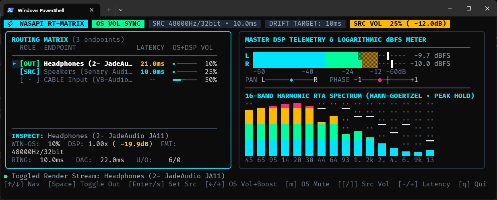

<div align="center">

# ⚡ Go Real-Time Audio Router & DSP Telemetry (`wasapi-router-go`)

**Ultra-low-latency cross-platform audio routing matrix (Windows WASAPI & Linux PipeWire Hi-Res Virtual Hub), 4-point Hermite cubic ASRC, cross-device latency synchronizer, and 30fps TUI spectrum analyzer built in pure Go.**

[](https://golang.org/)
[-0078D6?style=for-the-badge&logo=linux&logoColor=white)](https://pipewire.org/)
[](https://learn.microsoft.com/en-us/windows/win32/coreaudio/wasapi)
[](#-mathematical--dsp-formulations)
[](LICENSE)

*Simultaneously route, resample, phase-align, and analyze real-time system audio across heterogeneous hardware endpoints (PCIe Soundcards, USB DACs, HDMI, and Bluetooth A2DP) down to the sub-10ms hardware floor.*

[Overview](#-overview) • [UI Preview](#️-terminal-ui-preview) • [Key Features](#-key-architectural-features) • [Architecture](#-system-architecture) • [DSP Formulations](#-mathematical--dsp-formulations) • [Getting Started](#-getting-started) • [Research & Citation](#-academic-research--citation)

</div>

---

## 📖 Overview

**`wasapi-router-go`** is a zero-CGO, heap-safe **real-time audio routing matrix and DSP telemetry suite** written in pure Go for **Windows (WASAPI)** and **Linux / CachyOS (PipeWire / PulseAudio)**. Powered by [Bubble Tea](https://github.com/charmbracelet/bubbletea) and [Lip Gloss](https://github.com/charmbracelet/lipgloss), it captures system audio in native 32-bit float and mirrors it simultaneously across multiple heterogeneous output devices (USB DACs like the JadeAudio JA11, wired headphones, studio monitors, and Bluetooth speakers) down to the **~4–16ms hardware floor**.

Broadcasting real-time audio across multiple independent soundcards introduces two classic systems engineering challenges: **asynchronous crystal clock drift** (causing buffer underruns, overruns, or crackling artifacts) and **heterogeneous hardware buffer latencies** (causing acoustic echo/comb-filtering between speakers). Unlike standard audio routers that suffer from Go garbage-collection stutters, clock-drift pops, or digital attenuation loss, this engine implements:

1. **OS-Native Real-Time Thread Scheduling:** Windows MMCSS `Pro Audio` (`THREAD_PRIORITY_TIME_CRITICAL`) and Linux `SYS_SETPRIORITY` (`nice -15`) under CachyOS BORE / `scx` schedulers.
2. **Dedicated Linux Hi-Res Virtual Master Hub (`PW-Matrix Hi-Res Master Hub`):** Automatically spawns an isolated 32-bit float / 48kHz virtual sink on Linux, routes active desktop apps into it, and fans out equally to all physical hardware DACs with zero self-feedback loops.
3. **Wait-Free / Lock-Free Atomic SPSC Ring Buffers** with zero heap allocations on hot audio threads.
4. **4-Point Hermite Cubic Fractional Resampling (ASRC)** governed by a low-pass filtered drift servo to eliminate phase warbling and zipper noise.
5. **Automatic Cross-Device Latency Synchronization (`Sync Lock`)** & manual per-endpoint acoustic delay offsets.
6. **Bi-Directional Native OS Volume Synchronization** paired with a $+6.0\text{ dB}$ de-zippered DSP preamp.

---

## 🖥️ Terminal UI Preview



---

## ✨ Key Architectural Features

### 🏎️ Ultra-Low-Latency Audio Pipeline & Anti-Crackle ASRC
- **Real-Time Kernel Priority:**
  - **Windows (`main_windows.go`):** Pins capture and render goroutines to dedicated OS threads (`runtime.LockOSThread()`) and elevates them via `avrt.dll` (`AvSetMmThreadCharacteristicsW("Pro Audio")`) and `THREAD_PRIORITY_TIME_CRITICAL` (`15`).
  - **Linux / CachyOS (`main_linux.go`):** Locks OS threads by `SYS_GETTID`, elevates thread niceness to `-15` via `syscall.Setpriority`, and clamps Linux kernel pipe buffers via `fcntl(F_SETPIPE_SZ, 8192)` to eliminate stale kernel queue latency.
- **Dedicated Virtual Master Hub on Linux (`module-null-sink`):** Automatically provisions **`PW-Matrix Hi-Res Master Hub`** (`float32le`, `48000 Hz`, Stereo) on startup, sets it as the default system output, and migrates active audio streams into the hub. Every physical DAC sits on an identical downstream path (`Virtual Hub -> SPSC Ring Buffer -> Hardware Sink`), ensuring balanced multi-device latency and clean automatic teardown on exit (`SIGINT`/`SIGTERM`).
- **4-Point Hermite Cubic ASRC & Smooth Drift Servo:** Bridges mismatched sample rates (e.g., $48\text{ kHz} \leftrightarrow 44.1\text{ kHz} \leftrightarrow 96\text{ kHz}$) on the fly using **3rd-order Hermite (Catmull-Rom) cubic interpolation**, preserving high-frequency response up to $20\text{ kHz}$. On Linux, an **Exponential Moving Average (EMA) Low-Pass Filter** and slew-rate limiter smooth out OS pipe read bursts before modulating the step ratio ($\pm 0.18\%$), completely eliminating pitch warble and crackling artifacts.
- **Pre-Priming & Bluetooth A2DP Hard-Snap Recovery:** Pre-charges ring buffers to $80\%$ of target latency before playback begins to prevent startup underruns, and hard-snaps read pointers if wireless transport stalls exceed tolerance.

### 🔗 Multi-Device Acoustic Synchronization & Persistence
- **Automatic Latency Sync Lock (`[a]`):** Continuously inspects hardware buffer sizes across all active outputs and dynamically delays faster DACs in their ring buffers so total acoustic latency matches the slowest active endpoint.
- **Per-Endpoint Manual Delay Offset (`[,]` / `[.]`):** Fine-tune acoustic phase alignment across physical speaker distances from `0ms` to `+1000ms` (`5ms` steps on Windows, ultra-fine `2ms` steps on Linux).
- **Atomic JSON State Persistence:** Automatically saves active routing topology, source selection, hybrid volume levels, mute states, and delay offsets (`wasapi_matrix_config.json` on Windows, `pipewire_matrix_config.json` on Linux) via atomic temporary-file swap.

### 🔊 Hybrid 2-Way OS Volume & DSP Preamp
- **Bi-Directional Native Volume Sync (`IAudioEndpointVolume` & `pactl`):**
  - **0% – 100% Range:** Directly controls and stays synchronized with the **Native OS Hardware Volume & Mute** state on both Windows and PipeWire/PulseAudio.
  - **Bit-Transparent Unity Gain:** While operating between `0%–100%`, internal DSP gain remains locked at `1.0x` (`0.0 dB`), avoiding double-attenuation and preserving full 24/32-bit dynamic range.
  - **100% – 150% Overdrive Preamp:** Pushing a slider past `100%` locks OS hardware volume at `100%` and seamlessly engages a floating-point digital preamp boost up to `+6.0 dB` (`2.0x`).
- **Exponential De-Zippering & Padé $\tanh$ Soft-Limiter:** Applies a per-sample one-pole IIR smoothing filter on gain transitions to eliminate zipper noise, paired with a rational Padé approximant $\tanh(x)$ soft-limiter above $\pm 0.99$ ($-0.08\text{ dBFS}$) to prevent harsh digital clipping while keeping normal audio bit-transparent.

### 🛡️ Memory-Safe Multi-Format PCM Engine
- **Zero-Allocation Hot Loop:** Lock-free atomic SPSC ring buffers (`SpscRingBuffer`) and pre-allocated scratch slices ensure zero heap allocations on real-time audio threads.
- **Heap-Safe Codec:** Supports native `float32le` streaming on PipeWire and dynamically parses `nBlockAlign` and `wBitsPerSample` across **16-bit Signed Integer**, **24-bit Packed Integer**, and **32-bit IEEE Float** streams on Windows WASAPI.

### 📊 Real-Time DSP Telemetry Suite
- **Logarithmic dBFS VU Meters:** Dual-channel RMS + Peak bar graphs (`-60 dBFS` to `+3 dBFS`) with decaying peak-hold markers.
- **Stereo Phase & Panning Scope:** Real-time L/R energy balance meter and Pearson stereo phase correlation indicator (`-1.0` out-of-phase to `+1.0` mono).
- **16-Band Hann-Goertzel RTA Spectrum:** Logarithmic frequency bands (`45 Hz` – `13 kHz`) computed via windowed 2nd-order Goertzel IIR resonators with sub-character Unicode block resolution (`▁▂▃▄▅▆▇█`) and gravity-decay peak hold caps.

---

## 📐 System Architecture

```text
                        ┌───────────────────────────────────────────────┐
                        │   OS Volume Sync (WASAPI COM / PipeWire pactl)│
                        │     ◄─── 2-Way Sync (Poll / Cmd Queue) ───►   │
                        └───────────────────────┬───────────────────────┘
                                                │
┌───────────────────────┐   Low-Latency Stream  ▼
│  Capture Source       │ ──(3ms-12ms)──► ┌───────────────────────────┐
│  • Win: WASAPI Loop   │   Raw PCM /     │   Decode to Stereo Float  │
│  • Lin: Virtual Hub   │   32-bit Float  │ + Padé tanh Soft-Limiter  │
└───────────────────────┘                 └─────────────┬─────────────┘
                                                        │ Normalized Stereo Float32
                        ┌───────────────────────────────┼───────────────────────────────┐
                        ▼                               ▼                               ▼
          ┌───────────────────────────┐   ┌───────────────────────────┐   ┌───────────────────────────┐
          │  Target #1 SpscRingBuffer │   │  Target #2 SpscRingBuffer │   │     DSP Telemetry Tap     │
          │   (Lock-Free Atomic SPSC) │   │   (Lock-Free Atomic SPSC) │   │ • RMS / Peak Hold (dBFS)  │
          └─────────────┬─────────────┘   └─────────────┬─────────────┘   │ • L/R Phase Correlation   │
                        │                               │                 │ • 16-Band Hann-Goertzel   │
                        ▼                               ▼                 └─────────────┬─────────────┘
          ┌───────────────────────────┐   ┌───────────────────────────┐                 │
          │   ReadStereoAdaptive()    │   │   ReadStereoAdaptive()    │                 ▼
          │ • 4-Pt Hermite Cubic ASRC │   │ • 4-Pt Hermite Cubic ASRC │   ┌───────────────────────────┐
          │ • EMA Smooth Drift Servo  │   │ • EMA Smooth Drift Servo  │   │   Bubble Tea 30fps TUI    │
          │ • Sync Lock + Offset Delay│   │ • Sync Lock + Offset Delay│   │ • Routing Matrix + Scopes │
          │ • One-Pole Vol De-Zipper  │   │ • One-Pole Vol De-Zipper  │   │ • Atomic JSON Persistence │
          └─────────────┬─────────────┘   └─────────────┬─────────────┘   └───────────────────────────┘
                        │                               │
                        ▼                               ▼
          ┌───────────────────────────┐   ┌───────────────────────────┐
          │  Target Endpoint #1 DAC   │   │  Target Endpoint #2 DAC   │
          └───────────────────────────┘   └───────────────────────────┘
```

---

## 🧮 Mathematical & DSP Formulations

For academic reproducibility and systems engineering reference, the core signal processing algorithms implemented in the engine are defined below.

### 1. Low-Pass Filtered Clock-Drift Servo & ASRC Step Ratio
Given capture sample rate $F_s^{\text{src}}$ and target render sample rate $F_s^{\text{dst}}$, let $N_{\text{avail}}[k]$ be the current readable frames in the SPSC ring buffer and $N_{\text{target}}$ be the desired target buffer fill. To prevent OS pipe burst jitter from modulating pitch, the buffer fill is smoothed via an Exponential Moving Average ($\beta = 0.04$) and slew-limited ($\gamma = 0.08$):

$$R_{\text{base}} = \frac{F_s^{\text{src}}}{F_s^{\text{dst}}}, \quad \bar{N}[k] = (1 - \beta)\bar{N}[k-1] + \beta N_{\text{avail}}[k], \quad e[k] = \bar{N}[k] - N_{\text{target}}$$

$$R_{\text{goal}}[k] = R_{\text{base}} \cdot \left( 1 + \text{clip}\left( K_p \cdot e[k], \, -\delta_{\max}, \, +\delta_{\max} \right) \right)$$

$$\Delta t[k] = (1 - \gamma)\Delta t[k-1] + \gamma R_{\text{goal}}[k]$$

### 2. 4-Point, 3rd-Order Hermite (Catmull-Rom) Cubic Interpolation
For integer frame index $n = \lfloor t \rfloor$ and fractional sub-sample phase $\mu = t - n \in [0, 1)$, each stereo channel is reconstructed from four adjacent ring-buffer samples $y[n-1], y[n], y[n+1], y[n+2]$ evaluated in Horner form:

$$\begin{aligned} c_0 &= y[n] \\ c_1 &= \frac{1}{2}\left(y[n+1] - y[n-1]\right) \\ c_2 &= y[n-1] - \frac{5}{2}y[n] + 2y[n+1] - \frac{1}{2}y[n+2] \\ c_3 &= \frac{1}{2}\left(y[n+2] - y[n-1]\right) + \frac{3}{2}\left(y[n] - y[n+1]\right) \\ \hat{y}(n + \mu) &= \left((c_3 \mu + c_2)\mu + c_1\right)\mu + c_0 \end{aligned}$$

### 3. Cross-Device Latency Synchronization (`AutoSyncMode`)
Across all active output endpoints $j \in \mathcal{T}$ with hardware buffer duration $B_j$ (in ms), manual user offset $O_j$ (in ms), and global latency floor $F_{\text{floor}}$, the target ring-buffer delay $L_i^{\text{ring}}$ (in ms) for endpoint $i$ is:

$$L_{\max} = \max_{j \in \mathcal{T}} \left( F_{\text{floor}} + 0.5 B_j + O_j \right), \quad L_i^{\text{ring}} = \max\left( F_{\text{floor}} + O_i, \, L_{\max} - 0.5 B_i \right)$$

### 4. One-Pole Exponential De-Zippering & Padé Rational Soft-Limiter
Instantaneous digital gain $G[n]$ tracks target gain $G_{\text{goal}}$ via a first-order low-pass IIR filter, followed by a bit-transparent rational soft-clipper above $-0.08\text{ dBFS}$ ($\lvert x \rvert \ge 0.99$):

$$G[n] = G[n-1] + \alpha \left( G_{\text{goal}} - G[n-1] \right), \quad f(x) = \begin{cases} x & \text{if } \lvert x \rvert < 0.99 \\ \text{sgn}(x) & \text{if } \lvert x \rvert > 3.0 \\ \dfrac{x(27 + x^2)}{27 + 9x^2} & \text{otherwise} \end{cases}$$

### 5. Stereo Phase Correlation & 16-Band Hann-Goertzel Spectrum
Zero-lag stereo phase correlation $\rho \in [-1, +1]$ and spectral magnitudes $\lvert X(\omega_b) \rvert$ across 16 logarithmic frequency centers $f_b = 45 \cdot (1.46)^b\text{ Hz}$ ($b \in [0, 15]$, window length $M \le 256$) are computed as:

$$\rho = \frac{\sum_{n=0}^{N-1} L[n] R[n]}{\sqrt{\sum_{n=0}^{N-1} L^2[n] \cdot \sum_{n=0}^{N-1} R^2[n]}}, \quad s_b[n] = w_{\text{Hann}}[n]\left(\frac{L[n]+R[n]}{2}\right) + 2\cos(\omega_b)s_b[n-1] - s_b[n-2]$$

---

## 🚀 Getting Started

### Prerequisites

- **Go:** Go `1.21+` (uses built-in `clear()` and `unsafe.Slice`)
- **Windows:** Windows 10 or Windows 11 (x64 / ARM64)
- **Linux (CachyOS / Arch / Fedora / Ubuntu):** `pipewire`, `pipewire-pulse`, and `libpulse` (`pactl`, `parec`, `pacat`)
  ```bash
  sudo pacman -S --needed pipewire pipewire-pulse libpulse
  ```

### Installation & Build

1. **Clone the repository:**
   ```bash
   git clone [https://github.com/masfana/wasapi-router-go.git](https://github.com/masfana/wasapi-router-go.git)
   cd wasapi-router-go
   ```

2. **Fetch dependencies:**
   ```bash
   go mod tidy
   ```

3. **Build & Run on Linux (CachyOS / PipeWire):**
   ```bash
   go build -ldflags="-s -w" -o pw-matrix .
   ./pw-matrix
   ```

4. **Build & Run on Windows (WASAPI):**
   ```powershell
   go build -ldflags="-s -w" -o wasapi-router.exe .
   .\wasapi-router.exe
   ```

---

## 🕹️ Keyboard Controls

| Keybinding | Action |
| :--- | :--- |
| **`↑` / `k`** , **`↓` / `j`** | Navigate up and down the audio endpoint routing matrix |
| **`Space`** | Toggle active audio mirroring (`[OUT]`) for the highlighted target endpoint (auto-saved) |
| **`Enter` / `s`** | **Windows:** Set highlighted endpoint as Loopback Source (`[SRC]`) • **Linux:** Toggle `[OUT]` |
| **`←` / `h`** , **`→` / `l`** | Adjust selected device volume (`±2%`): **0–100% Native OS Vol** / **100–150% DSP Boost** |
| **`m`** | Mute / Unmute the selected endpoint (syncs directly with Native OS Mute) |
| **`[` / `]`** | Decrease / Increase **Master Source / Virtual Hub Volume** (`±2%`) |
| **`M`** | Toggle **Master Source / Virtual Hub Mute** |
| **`,` / `.`** | Decrease / Increase per-device **Manual Delay Offset** (`0ms` to `+1000ms` in `2ms`/`5ms` steps) |
| **`a`** | Toggle **Auto Latency Sync Lock** (aligns all active outputs to the slowest endpoint's latency) |
| **`-` / `+`** | Tighten / Relax target **Ring Buffer Latency Floor** (`4ms`/`6ms` to `60ms` in `2ms` steps) |
| **`r`** | Re-enumerate active audio endpoints & route active Linux desktop streams into Virtual Hub |
| **`q` / `Ctrl+C`** | Save JSON config, stop streams, clean up Virtual Hub (Linux) / MMCSS (Windows), and exit |

---

## ⚡ Low-Latency & Multi-Speaker Tuning Guide

1. **Linux Virtual Hub Workflow (`PW-Matrix Hi-Res Master Hub`):**
   - On launch, the engine automatically creates the **`PW-Matrix Hi-Res Master Hub`** virtual sink, sets it as your system default, and moves running apps (Spotify, browsers, games) into it.
   - Simply press **`Space`** on all physical devices you want to hear (e.g., **JadeAudio JA11** + **Desktop Speakers**). When you quit with **`q`**, the virtual sink is automatically unloaded and your previous default hardware output is restored.
2. **Eliminating Room Echo Across Multiple Speakers (`SYNC LOCK` + `OFFSET`):**
   - Enable **`[a]` (`SYNC LOCK`)** to automatically match software ring-buffer latencies across all active outputs.
   - If a USB DAC or Bluetooth codec introduces extra hardware transport delay, highlight the faster speaker and press **`.`** (`+2ms` on Linux, `+5ms` on Windows) until both outputs sound phase-locked.
3. **Ultra-Low-Latency Monitoring:**
   - Use **`-` / `+`** to dial the **Ring Buffer Floor**: `14ms–16ms` provides glitch-free Hi-Res stability under heavy CPU load on Linux PipeWire, while `4ms–8ms` can be used for ultra-tight wired monitoring.

---

## 🔬 Academic Research & Citation

**`wasapi-router-go`** is architected as a clean-room reference implementation suitable for computer science and audio engineering research in:
- **Real-Time Operating Systems (RTOS) & Multimedia Scheduling:** Empirical evaluation of Windows MMCSS `Pro Audio` thread boosting and Linux CachyOS BORE / PipeWire quantum scheduling in garbage-collected runtimes (Go).
- **Lock-Free Concurrent Data Structures:** Throughput and worst-case execution time (WCET) analysis of atomic Single-Producer Single-Consumer (SPSC) ring buffers under multi-consumer fan-out workloads.
- **Adaptive Digital Signal Processing:** Comparative $\text{THD+N}$ and phase-jitter analysis of low-pass filtered clock-drift feedback controllers with 3rd-order Hermite cubic fractional interpolation across asynchronous DAC clock domains.

### BibTeX Citation

If you reference this software, its DSP pipeline, or its concurrency architecture in an academic paper, thesis, or technical report, please cite:

```bibtex
@software{wasapi_router_go_2026,
  author       = {Masfana},
  title        = {{wasapi-router-go: Ultra-Low-Latency Cross-Platform Audio Loopback Mirroring Engine, Hermite Cubic ASRC, and Real-Time DSP Telemetry in Go}},
  year         = {2026},
  publisher    = {GitHub},
  journal      = {GitHub repository},
  howpublished = {\url{[https://github.com/masfana/wasapi-router-go](https://github.com/masfana/wasapi-router-go)}}
}
```

---

## 🛠️ Tech Stack

- **[Charm Bracelet Bubble Tea](https://github.com/charmbracelet/bubbletea) & [Lip Gloss](https://github.com/charmbracelet/lipgloss):** Functional Elm-architecture TUI & declarative terminal layout styling.
- **Linux PipeWire / PulseAudio Interop (`main_linux.go`):** Zero-CGO `module-null-sink` virtual hub management, `pactl` JSON state synchronization, `F_SETPIPE_SZ` kernel pipe tuning, and `SYS_SETPRIORITY` real-time thread elevation.
- **[moutend/go-wca](https://github.com/moutend/go-wca) & [go-ole](https://github.com/go-ole/go-ole) (`main_windows.go`):** Pure Go COM bindings for `IMMDeviceEnumerator`, `IAudioClient`, `IAudioCaptureClient`, `IAudioRenderClient`, and `IAudioEndpointVolume`.
- **Windows System Interop (`golang.org/x/sys/windows`):** Kernel event handles (`CreateEvent`, `WaitForSingleObject`) and lazy-loaded `avrt.dll` / `kernel32.dll` syscalls for MMCSS `Pro Audio` real-time thread scheduling.

---

## 🛡️ License

Distributed under the **MIT License**. See [`LICENSE`](LICENSE) for full details.
