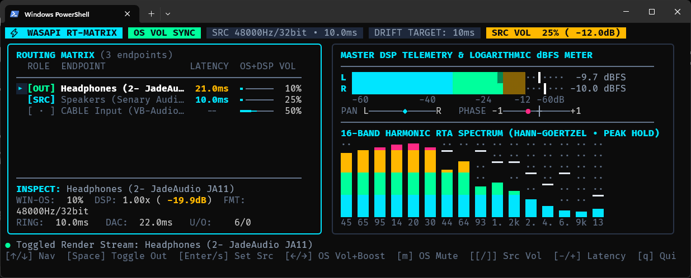

<div align="center">

# ⚡ Go WASAPI Real-Time Audio Router & DSP Telemetry

**Ultra-low-latency Windows Core Audio loopback mirroring engine, adaptive clock-drift resampler, and 60fps/30fps TUI spectrum analyzer built in pure Go.**

[](https://golang.org/)
[](https://www.microsoft.com/windows)
[](https://learn.microsoft.com/en-us/windows/win32/coreaudio/wasapi)
[](LICENSE)

</div>

---

## 📖 Overview

**`wasapi-router-go`** is a zero-CGo, heap-safe **Windows Audio Session API (WASAPI) loopback router and real-time DSP telemetry suite** built in Go. Powered by [Bubble Tea](https://github.com/charmbracelet/bubbletea) and [Lip Gloss](https://github.com/charmbracelet/lipgloss), it captures system audio from any active Windows render endpoint and mirrors it simultaneously across multiple output devices (USB DACs, headphones, speakers, virtual cables) down to the **~5–12ms shared-mode hardware floor**.

Unlike standard audio routers that suffer from Go garbage-collection stutters, clock-drift pops, or digital attenuation loss, this engine implements **Windows MMCSS `Pro Audio` real-time thread scheduling**, **lock-free SPSC ring buffers**, **fractional linear resampling**, and **bi-directional Windows Native Volume synchronization**.

---

## 🖥️ Terminal UI Preview



---

## ✨ Key Architectural Features

### 🏎️ Ultra-Low-Latency Audio Pipeline
- **MMCSS `Pro Audio` Kernel Priority:** Pins capture and render goroutines to dedicated OS threads (`runtime.LockOSThread()`) and elevates them via `avrt.dll` (`AvSetMmThreadCharacteristicsW("Pro Audio")`) and `THREAD_PRIORITY_TIME_CRITICAL` to prevent Windows background preemption or Go GC jitter.
- **Sub-10ms Period Negotiation:** Requests `AUDCLNT_STREAMFLAGS_LOWLATENCY` with minimum hardware device periods (`minPeriod`), cutting shared-mode engine ticks down to `3ms–5ms` where supported by the audio driver.
- **Click-Free Fractional Drift Resampler:** Eliminates phase discontinuities (pops/clicks) caused by crystal oscillator clock drift between different soundcards. A proportional feedback controller dynamically adjusts fractional interpolation step ratios ($\pm 0.5\%$) to keep each target's ring buffer locked to your target latency floor (`4ms–50ms`).

### 🔊 Hybrid 2-Way Windows OS Volume & DSP Preamp
- **Bi-Directional Native Volume Sync (`IAudioEndpointVolume`):**
  - **0% – 100% Range:** Directly controls and stays synchronized with the **Windows Native Hardware Volume & Mute** state. Changing volume in the TUI moves the Windows 10/11 system tray slider in real time, and physical media wheel adjustments sync back into the TUI within `150ms`.
  - **Bit-Perfect Unity Gain:** While operating between `0%–100%`, internal DSP gain remains locked at `1.0x` (`0.0 dB`), avoiding double-attenuation and preserving full 24/32-bit dynamic range.
  - **100% – 150% Overdrive Preamp:** Pushing a slider past `100%` locks Windows hardware volume at `100%` and seamlessly engages a de-zippered digital preamp boost up to `+6.0 dB` (`2.0x`).
- **Exponential De-Zippering & Soft-Knee $\tanh$ Limiter:** Applies a per-sample one-pole smoothing filter ($\alpha = 0.0025$) on gain transitions to eliminate zipper noise, paired with a fast Padé approximant $\tanh(x)$ soft-knee limiter above $\pm 0.90$ to prevent harsh digital clipping.

### 🛡️ Memory-Safe Multi-Format PCM Engine
- **Zero-Allocation Hot Loop:** Lock-free atomic SPSC ring buffers (`SpscRingBuffer`) and pre-allocated scratch slices ensure zero heap allocations on real-time audio threads.
- **Heap-Safe BlockAlign Codec:** Prevents Windows `0xc0000374` (`STATUS_HEAP_CORRUPTION`) crashes by dynamically parsing `nBlockAlign` and `wBitsPerSample` across **16-bit Signed Integer**, **24-bit Packed Integer**, and **32-bit IEEE Float** streams, with automatic upmixing for 5.1/7.1 surround endpoints.
- **COM Memory Hygiene:** Strictly isolates `CoInitializeEx` states per thread and frees `WAVEFORMATEX` structures via `CoTaskMemFree`.

### 📊 Real-Time DSP Telemetry Suite
- **Logarithmic dBFS VU Meters:** Dual-channel RMS + Peak bar graphs (`-60 dBFS` to `0 dBFS`) with decaying peak-hold markers.
- **Stereo Phase & Panning Scope:** Real-time L/R energy balance meter and stereo phase correlation indicator (`-1.0` out-of-phase to `+1.0` mono).
- **16-Band Hann-Goertzel RTA Spectrum:** Logarithmic ISO frequency bands (`45 Hz` – `13 kHz`) with sub-character Unicode block resolution (`▁▂▃▄▅▆▇█`) and gravity-decay peak caps.

---

## 📐 System Architecture

```text
                        ┌───────────────────────────────────────────────┐
                        │     Windows OS Volume (IAudioEndpointVolume)  │
                        │     ◄─── 2-Way Sync (150ms Poll / Cmd) ───►   │
                        └───────────────────────┬───────────────────────┘
                                                │
┌───────────────────────┐   Event Callback      ▼
│  Source Audio Device  │ ──(3ms-10ms)──► ┌───────────────────────────┐
│  (WASAPI Loopback)    │   Raw PCM       │   decodeToStereoFloat()   │
└───────────────────────┘   16/24/32-bit  │ + Soft-Knee tanh Limiter  │
                                          └─────────────┬─────────────┘
                                                        │ Normalized Stereo Float32
                       ┌────────────────────────────────┼────────────────────────────────┐
                       ▼                                ▼                                ▼
         ┌───────────────────────────┐    ┌───────────────────────────┐    ┌───────────────────────────┐
         │  Target #1 SpscRingBuffer │    │  Target #2 SpscRingBuffer │    │     DSP Telemetry Tap     │
         │   (Lock-Free Atomic SPSC) │    │   (Lock-Free Atomic SPSC) │    │  • RMS / Peak Hold (dBFS) │
         └─────────────┬─────────────┘    └─────────────┬─────────────┘    │  • L/R Phase Correlation  │
                       │                                │                  │  • 16-Band Hann-Goertzel  │
                       ▼                                ▼                  └─────────────┬─────────────┘
         ┌───────────────────────────┐    ┌───────────────────────────┐                  │
         │   ReadStereoAdaptive()    │    │   ReadStereoAdaptive()    │                  ▼
         │ • PI Clock-Drift Resample │    │ • PI Clock-Drift Resample │    ┌───────────────────────────┐
         │ • One-Pole Vol De-Zipper  │    │ • One-Pole Vol De-Zipper  │    │    Bubble Tea 30fps TUI   │
         └─────────────┬─────────────┘    └─────────────┬─────────────┘    │  Compact Matrix + Scopes  │
                       │                                │                  └───────────────────────────┘
                       ▼                                ▼
         ┌───────────────────────────┐    ┌───────────────────────────┐
         │  Target Endpoint #1 DAC   │    │  Target Endpoint #2 DAC   │
         └───────────────────────────┘    └───────────────────────────┘
```

---

## 🚀 Getting Started

### Prerequisites

- **OS:** Windows 10 or Windows 11 (x64 / ARM64)
- **Go:** Go `1.21+` (uses built-in `clear()` and `unsafe.Slice`)

### Installation & Build

1. **Clone the repository:**
   ```bash
   git clone [https://github.com/masfana/wasapi-router-go.git](https://github.com/masfana/wasapi-router-go.git)
   cd wasapi-router-go
   ```

2. **Fetch dependencies:**
   ```bash
   go mod tidy
   ```

3. **Run directly:**
   ```bash
   go run main.go
   ```

4. **Build an optimized standalone binary (Recommended for lowest latency):**
   ```bash
   go build -ldflags="-s -w" -o wasapi-router.exe main.go
   .\wasapi-router.exe
   ```

---

## 🕹️ Keyboard Controls

| Keybinding | Action |
| :--- | :--- |
| **`↑` / `k`** , **`↓` / `j`** | Navigate up and down the audio endpoint matrix |
| **`Space`** | Toggle active audio mirroring (`[OUT]`) for the highlighted target endpoint |
| **`Enter` / `s`** | Set the highlighted endpoint as the active **Loopback Capture Source (`[SRC]`)** |
| **`←` / `h`** , **`→` / `l`** | Adjust selected device volume (`±2%`): **0–100% Native Windows OS Vol** / **100–150% DSP Boost** |
| **`m`** | Mute / Unmute the selected endpoint (syncs directly with Windows Native Mute) |
| **`[` / `]`** | Decrease / Increase **Capture Source Master Volume** (`±2%`) |
| **`M`** | Toggle **Capture Source Master Mute** (mutes OS endpoint + loopback feed) |
| **`-` / `+`** | Tighten / Relax target **Ring Buffer Latency Floor** (`4ms` to `50ms` in `2ms` steps) |
| **`r`** | Re-enumerate active Windows WASAPI endpoints & resync OS volume states |
| **`q` / `Ctrl+C`** | Gracefully stop all audio streams, revert MMCSS handles, and exit |

---

## ⚡ Low-Latency Tuning Guide

To achieve the lowest possible glass-to-glass latency (`~5–10ms`) without buffer underruns (`U/O`):

1. **Match Sample Rates in Windows Sound Settings (`mmsys.cpl`):**
   Set your Capture Source and Target Render devices to the same sample rate (e.g., **24-bit or 32-bit, 48000 Hz**) under *Sound Control Panel ➔ Properties ➔ Advanced*. This allows Windows to bypass internal kernel sample-rate conversion filters.
2. **Tune the Drift Target Floor (`-` / `+` keys):**
   - **Default (`10ms`):** Rock-solid stability across USB DACs, onboard audio, and wireless headsets.
   - **Ultra-Low (`4ms` – `6ms`):** Ideal for wired PCIe/USB interfaces when playing rhythm games, monitoring synths, or real-time voice routing. If you see the `U/O` underrun counter increment under heavy CPU load, relax the floor by `+2ms`.

---

## 🛠️ Tech Stack

- **[Charm Bracelet Bubble Tea](https://github.com/charmbracelet/bubbletea) & [Lip Gloss](https://github.com/charmbracelet/lipgloss):** Functional Elm-architecture TUI & declarative terminal layout styling.
- **[moutend/go-wca](https://github.com/moutend/go-wca) & [go-ole](https://github.com/go-ole/go-ole):** Pure Go COM bindings for `IMMDeviceEnumerator`, `IAudioClient`, `IAudioCaptureClient`, `IAudioRenderClient`, and `IAudioEndpointVolume`.
- **Windows System Interop (`golang.org/x/sys/windows`):** Kernel event handles (`CreateEvent`, `WaitForSingleObject`) and lazy-loaded `avrt.dll` / `kernel32.dll` syscalls for MMCSS `Pro Audio` real-time thread scheduling.

---

## 🛡️ License

Distributed under the **MIT License**. See [`LICENSE`](LICENSE) for full details.
